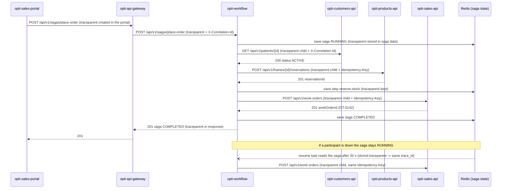

# CP1 - Critical journey and trace map

## Journey: a seller places an order (quotation) for a frame

A seller in `opti-sales-portal` picks an active patient and a frame and presses "Create
quotation". The request goes through `opti-api-gateway` (nginx) to `opti-workflow`, which runs the
`place-order` saga (ADR-004): `check-patient` -> `reserve-stock` -> `open-order`. If a step fails,
the completed steps are compensated in reverse order (release the reservation, cancel the order).

Today the only shared id is `X-Correlation-Id` (the gateway creates it from `$request_id`, every
`CorrelationFilter` keeps it, `ParticipantClient` copies it). The proposal is to add W3C
`traceparent` next to it, so each hop is a span of the same trace.

## Hop table

| Step | Caller | Callee | Protocol | Operation | Sync/Async | Data touched |
|---|---|---|---|---|---|---|
| 1 | opti-sales-portal | opti-api-gateway | REST (HTTPS) | `POST /api/v1/sagas/place-order` | sync | none (gateway only checks the bearer token and rate limit) |
| 2 | opti-api-gateway | opti-workflow | REST | `POST /api/v1/sagas/place-order` (`Idempotency-Key`) | sync | Redis: saga state `RUNNING` |
| 3 | opti-workflow | opti-customers-api | REST | `GET /api/v1/patients/{patientId}` | sync | `customers.patient` (read, must be `ACTIVE`) |
| 4 | opti-workflow | opti-products-api | REST | `POST /api/v1/frames/{frameId}/reservations` (key `<sagaId>:reserve-stock`) | sync | `products.frame`, `products.stock_reservation`, `products.stock_movement` |
| 5 | opti-workflow | opti-sales-api | REST | `POST /api/v1/work-orders` (key `<sagaId>:open-order`) | sync | `sales.work_order`, `sales.work_order_item`, `sales.invoice` |
| 6 | opti-workflow | Redis | RESP | save saga state after each step | async boundary | saga hash with `completedSteps` and the saved `traceparent` |
| 7 | opti-workflow (resume task) | opti-products-api / opti-sales-api | REST | resume a saga stuck in `RUNNING`/`COMPENSATING` after `SAGA_RESUME_AFTER` (30 s) | async | same tables as steps 4 and 5 |

Step 6 and 7 are the asynchronous boundary of this journey: when a participant is down, the
HTTP request ends and the saga is finished later by the background resume task, on another thread
and maybe on another instance. To keep the same `trace_id` there, the workflow stores the
`traceparent` inside the saga state in Redis and the resume task reads it back (a span link).
The `OrdenCreada` event to `ms-facturacion` (02-domain/domain-events.md) would be a second async
boundary, but the broker is not chosen yet, so it is not in this map.

## Sequence diagram



## Span tree

```
trace_id 4bf92f3577b34da6a3ce929d0e0e4736
- [root] opti-sales-portal  click "Create quotation"                      (client span)
  - opti-api-gateway   POST /api/v1/sagas/place-order                     (server span)
    - opti-workflow    POST /api/v1/sagas/place-order                     (server span)
      - opti-workflow  saga place-order                                   (internal span)
        - opti-workflow   step check-patient -> GET customers-api         (client span)
          - opti-customers-api GET /api/v1/patients/{id}                  (server span)
            - SELECT customers.patient                                    (db span)
        - opti-workflow   step reserve-stock -> POST products-api         (client span)
          - opti-products-api POST /api/v1/frames/{id}/reservations       (server span)
            - INSERT products.stock_reservation / stock_movement          (db span)
        - opti-workflow   step open-order -> POST sales-api               (client span)
          - opti-sales-api POST /api/v1/work-orders                       (server span)
            - INSERT sales.work_order / work_order_item / invoice         (db span)
        - opti-workflow   HSET saga state in Redis                        (client span)
  - [async, same trace_id] opti-workflow resume-saga                      (link to the saga span,
      reads traceparent from Redis)                                        new thread or instance)
      - opti-workflow   step open-order (retry) -> POST sales-api
        - opti-sales-api POST /api/v1/work-orders (Idempotency-Key repeats, no duplicate order)
```

## What travels on each hop

| Hop | Trace context | Other headers that matter |
|---|---|---|
| portal -> gateway | `traceparent` (new root) | `Authorization: Bearer` (never logged), `Idempotency-Key` |
| gateway -> workflow | `traceparent` passed as is, `X-Correlation-Id` (`$correlation_id`) | same `Idempotency-Key` |
| workflow -> domain APIs | new child `traceparent`, same `X-Correlation-Id` | service token (not the user's), `<sagaId>:<step>` key |
| workflow -> Redis -> resume task | `traceparent` saved as a field of the saga | `sagaId` is the lookup key |
