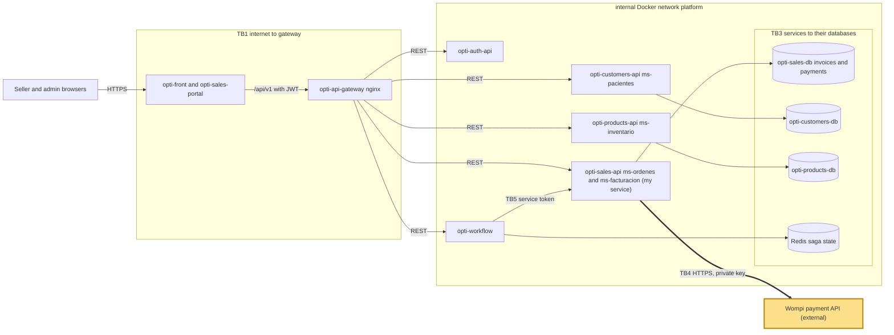

# CP1 - Attack surface map

System: OptiView (team The Illusionists). Names follow `05-architecture/overview.md` of `opti-docs`
(`api-gateway`, `ms-ordenes` and `ms-facturacion`, both implemented by `opti-sales-api`). My boundary is
**TB4**: `opti-sales-api` to the external payment API (Wompi).

## Data flow and trust boundaries

| Id | Boundary | Mine |
|---|---|---|
| TB1 | internet (browsers) to `opti-front` and `opti-api-gateway` | no |
| TB2 | `opti-api-gateway` to each service | no |
| TB3 | each service to its own PostgreSQL database and `opti-workflow` to Redis | no |
| TB4 | `opti-sales-api` to the external payment API (Wompi) | **yes** |
| TB5 | `opti-workflow` to the three domain services (service token) | no |

## Asset inventory

| Asset | Where it lives | Classification |
|---|---|---|
| Wompi keys: `WOMPI_PUBLIC_KEY`, `WOMPI_PRIVATE_KEY`, `WOMPI_INTEGRITY_SECRET` | environment of `opti-sales-api` | Restricted |
| Customer phone number for Nequi (taken from the `reference` of the payment) | request, `payments.reference` in `opti-sales-db`, call to Wompi | Confidential |
| Payment amount and invoice balance | `opti-sales-db`, request to Wompi | Confidential |
| Wompi transaction id (`gatewayTransactionId`) | `payments` table | Internal |
| Access token of the user (JWT RS256 with role) | `Authorization` header | Restricted |

## Entry points of TB4

`opti-sales-api` calls Wompi only inside `POST /api/v1/invoices/{id}/payments` (roles `ADMIN` and `SELLER`),
and only for the method `NEQUI`; other methods use a local sandbox gateway. The calls are:
`GET {WOMPI_BASE_URL}/merchants/{publicKey}`, `POST /tokens/nequi` (phone), `GET /tokens/nequi/{token}`
(polled every 2 s, at most 6 times) and `POST /transactions` (with `reference`, amount and an integrity
`signature`). The private key travels as bearer token. `WOMPI_BASE_URL` defaults to
`https://sandbox.wompi.co/v1`.
